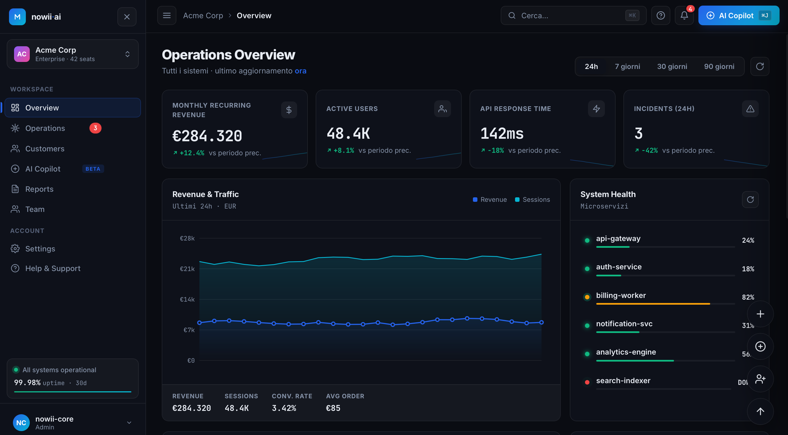

# nowii·ai — Enterprise AI Operations

<p align="center">
  <b>An Enterprise AI Operations Platform Built with Pure HTML, CSS, and JavaScript. No External Dependencies, No Backend.</b>
</p>

<p align="center">
  <a href="https://github.com/nowii-core/Workspace/blob/main/LICENSE">
    
  </a>
  
  
  
  
</p>

<p align="center">
  <a href="#-overview">Overview</a> •
  <a href="#-key-features">Features</a> •
  <a href="#-tech-stack">Tech Stack</a> •
  <a href="#-keyboard-shortcuts">Shortcuts</a> •
  <a href="#-quick-start">Quick Start</a> •
  <a href="#-contact">Contact</a>
</p>

---

</div>

## Overview

**nowii·ai** is a comprehensive, enterprise-grade AI Operations platform that runs entirely in the browser. Built completely from scratch using native web technologies, it delivers a seamless, high-performance experience without relying on heavy frameworks, external libraries, or backend servers. It simulates a full-scale AI operations center, complete with real-time metrics, interactive data visualizations, and a built-in AI Copilot.

---

## Preview



> **Live Demo:** [nowii-core.github.io/Workspace/nowii-ai/](https://nowii-core.github.io/Workspace/nowii-ai/)

---

## Key Features

- **Multi-Tenant Dashboard:** Seamless workspace switching for managing multiple environments.
- **Live KPIs:** Summary cards featuring animated count-up metrics and dynamic sparklines.
- **Canvas Chart:** Interactive rendering of Revenue vs. Traffic with timeframe selection.
- **World Map:** Real-time visualization featuring data center nodes and animated connection lines.
- **Operations Center:** Filterable, sortable event table with bulk selection capabilities.
- **Customer CRM:** Comprehensive client management with health scores, sentiment analysis, and 360° detail views.
- **AI Copilot:** Built-in assistant featuring 7 response patterns and letter-by-letter streaming output.
- **Copilot Drawer:** A persistent, accessible side drawer for quick AI interactions.
- **Command Palette (⌘K):** Instant access to 20+ commands and quick actions.
- **Inline Quick Search (`/`):** Rapid search functionality across events, customers, and team members.
- **Reports & Export:** Generate detailed reports with full CSV and JSON export capabilities.
- **Team Management:** Live presence indicators for team members.
- **Notifications:** Badge indicators and a centralized notification center.
- **Modal Actions:** Create incidents, customers, and invites via clean modal interfaces.
- **Auto-Refresh:** Configurable live data updates every 30 seconds.
- **Theme & Layout:** Light/dark mode toggle with customizable UI density.
- **Magnetic Effects:** Interactive UI elements toggleable from the settings menu.
- **Onboarding Tour:** Guided tour upon first launch.
- **Auto-Save:** Automatic persistence of state and preferences via `localStorage`.
- **Keyboard Shortcuts:** Comprehensive keyboard navigation for power users.

---

## Tech Stack

### Frontend
- **HTML5:** Semantic markup and structure.
- **CSS3:** Advanced layout with Grid and Flexbox, custom properties, `backdrop-filter`, and complex animations.
- **JavaScript (ES6+):** Native DOM manipulation, Canvas 2D API, `localStorage`, `MutationObserver`, and Event Delegation.

---

## Keyboard Shortcuts

| Key | Action |
| :--- | :--- |
| `⌘ K` / `Ctrl K` | Open command palette |
| `⌘ J` / `Ctrl J` | Open AI Copilot drawer |
| `/` | Focus quick search |
| `R` | Refresh data |
| `1` - `6` | Navigate between views |
| `ESC` | Close modal / drawer |

---

## Quick Start

### Prerequisites
No build step, server, or package manager is required.

### Installation

1. **Clone the repository:**
   ```bash
   git clone https://github.com/nowii-core/Workspace.git
   cd Workspace
   ```

2. **Run the application:**
   Simply open the `index.html` file in your preferred modern web browser.

### Deployment (GitHub Pages)
To deploy this application via GitHub Pages:
1. Navigate to your repository **Settings**.
2. Go to the **Pages** section.
3. Under **Branch**, select `main` and choose the `/` (root) folder.
4. Click **Save**.

---

## Contact & Support

- **Maintainer:** [@nowii-core](https://github.com/nowii-core)
- **Bug Reports & Feature Requests:** If you encounter an issue or would like to suggest an improvement, open an [Issue](https://github.com/nowii-core/Workspace/issues) or submit a [Pull Request](https://github.com/nowii-core/Workspace/pulls).

---

<div align="center">
  <sub>Developed by <b>nowii-core</b></sub>
</div>
